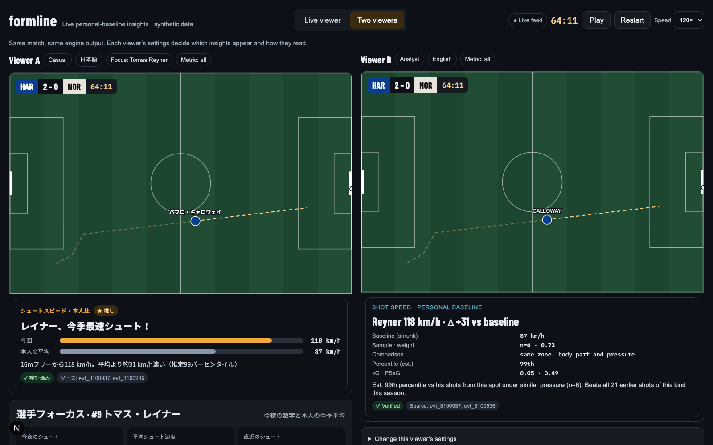
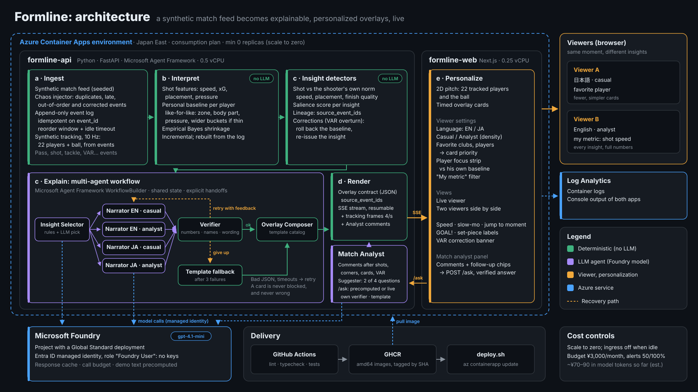

# Formline

[](https://github.com/roymwxuk/mwx-hackathon-formline/actions/workflows/ci.yml)

**Statcast-style personal baselines for football, live and personalized.** Formline turns a
live stream of match events into explainable on-screen insights that compare each shot with
*the shooter's own history*, written by a team of AI agents on **Microsoft Agent Framework**
and **Microsoft Foundry**, checked number by number, and running on **Azure Container Apps**.

Built for the *Inside the Game* Developer Hackathon (Microsoft × Premier League). Target
category: **Best Multi-Agent Orchestration**. All data is synthetic.



*Same moment, same engine output, two viewers. Left: casual, Japanese, following Reyner.
Right: analyst, English, every number. Both cards were written by agents on a Foundry model
and passed the verifier; each cites its source events. All 22 players and the ball come from
synthetic tracking derived from the events.*

## The problem

Broadcast stats are generic: "shot speed 118 km/h" means little unless you know what is
normal *for that player, from that spot, under that pressure*. Baseball solved this with
pitch-by-pitch comparisons against each pitcher's norms; football coverage rarely does it.
And when an LLM writes on-screen text live, one wrong number or name on air is a real cost.

## What Formline does

- **Compares like with like.** Each shot is measured against the shooter's own comparable
  shots (zone, body part, pressure), widening the comparison when his sample is thin, and
  saying so.
- **Never overclaims.** Small samples are shrunk toward his position group (empirical
  Bayes), so a player with three shots never gets a confident percentile; probabilities are
  always worded as model estimates.
- **Explains why it matters**, in the viewer's language and depth: casual cards are short
  and simple; analyst cards show baseline, sample size, weight, comparison group, xG.
- **Personalizes what appears**, not just the wording: favorite clubs and players win the
  card slot, casual fans with favorites see only theirs, "my metric" switches the card to
  that metric (at 40:12 a shot-speed viewer gets Reyner's speed card while everyone else
  gets his placement card: [speed](docs/ui/live/my-metric-speed-40m.png) vs
  [all](docs/ui/live/my-metric-all-40m.png)),
  and player focus keeps a running strip of one player vs his own norm.
- **Stays correct when the feed is messy.** Duplicates, late and out-of-order events and
  corrections are absorbed; when VAR overturns a goal, every dependent card is retracted or
  corrected through its lineage and the baseline update is rolled back.
- **Explains key moments as they happen.** A Match Analyst agent writes a short, verified
  comment after every shot, corner and card, in English or Japanese, from the facts the data
  holds (distance, pressure, chance quality, placement, the build-up, fouls tonight) and shows
  its evidence; it says when the data cannot answer (e.g. who was fouled). For each comment
  it offers 2–3 follow-up questions ("Why is it 1–0?", "How is Ito doing tonight?", "Compare
  the teams"), picked by a Suggester agent from a fixed catalog; a click returns a verified
  answer with its evidence.
  The panel has two tabs: *Commentary* and *Ask the analyst*: the latest moment's two
  suggested questions, a box to type your own, and the answers asked so far. A typed question
  is answered "RAG over computed facts": a Question Router agent retrieves the 1–3 fact
  sections that answer it (e.g. "why haven't NOR scored?" → *Northgate Rovers tonight*, all
  computed by code from the events), the Match Analyst answers the question itself from only
  those facts and says when they only partly answer it, and the verifier checks every number
  and name. Questions the data cannot answer (weather, opinions) are politely declined.
- **Shows the match, not just the numbers.** A 2D pitch draws all 22 players and the ball
  from synthetic 10 Hz tracking (derived from the events, ADR-010), with a GOAL! flash,
  set-piece labels (throw-in, corner, goal kick), speeds from 1× to 120× with an optional
  slow-mo around shots, and a Jump to menu for the key moments.

Example cards from the demo match (63:44, Foundry-narrated, verified):

| Viewer | Card |
|---|---|
| English · casual | **Reyner fires his fastest shot this season.** 118 km/h, about 31 km/h above his norm, 99th percentile vs his shots from this spot under similar pressure. |
| English · analyst | **Reyner 118 km/h · Δ +31 vs baseline.** Est. 99th percentile vs his shots from this spot under similar pressure (n=6). Beats all 21 earlier shots of this kind this season. |
| 日本語 · casual | **レイナー、今季最速シュート！** 16mフリーから118 km/h。平均より約31 km/h速い（推定99パーセンタイル） |
| After VAR (65:24) | **Goal disallowed after review.** 1 overlay(s) withdrawn, 1 corrected; baselines rebuilt from the event log. |

## Results at a glance

| Claim | Result | How it is measured |
|---|---|---|
| The verifier catches wrong numbers and names | **99.6%** of 1,075 injected errors, **0** false positives | [docs/verifier-catch-rate.md](docs/verifier-catch-rate.md) |
| Messy feeds converge to the same state | **300 / 300** chaotic replays equal the batch rebuild | `python -m formline.convergence`, `hypothesis` tests in CI |
| Shrinkage makes baselines more accurate | **30%** lower error than raw averages (**45%** for 1–4 shots) | [docs/shrinkage-accuracy.md](docs/shrinkage-accuracy.md) |
| The synthetic data is football-realistic | **14 / 14** event checks within range of league aggregates | [docs/realism-report.md](docs/realism-report.md) |
| Tracking agrees with the events | **99.5%** of players on their event spots (within 0.5 m); distance covered is low (about 8 km per 90, real 10–12 km), reported honestly | [realism report, tracking section](docs/realism-report.md) |
| Agents produce usable text | **80 / 80** Foundry card texts verified for the demo match (no template fallbacks) | `formline-gen overlays` run summary |
| The Match Analyst writes verified commentary | **96 / 96** comments and **190 / 192** follow-up answers written by the model and verified (2 template fallbacks); **48 / 48** question picks by the Suggester | `formline-gen analyst` run summary, ADR-011 |
| Cost | about **¥70–90** in model tokens for all runs so far (estimate; Azure billing lags); apps scale to zero | [ADR-009](docs/decisions.md), ADR-011 |

## How it works

The five stages of the brief, end to end:

| Stage | Where | Status |
|---|---|---|
| a. Ingest | `generator/` (synthetic feed), `engine/log.py` + `engine/ingest.py` (append-only log, dedupe, reorder window with an idle timeout, corrections), `tracking/` (22 players and the ball at 10 Hz, derived from events), `replay.py` | ✅ |
| b. Interpret | `engine/`: shot features (xG, PSxG, placement), like-for-like baselines with empirical Bayes shrinkage | ✅ |
| c. Explain | `engine/insights.py` (deterministic insights with lineage) + `agents/` (Selector, Narrator, Verifier, Composer on Microsoft Agent Framework, `gpt-4.1-mini` on Foundry) + `analyst/` (comments on shots, corners and cards; follow-up questions picked by a Suggester, answered by `/ask`) | ✅ |
| d. Render | overlay contract (`docs/contracts/overlay.schema.json`), timed overlays and tracking frames over SSE, viewer in `frontend/` | ✅ |
| e. Personalize | EN/JA, casual/analyst, favorite clubs and players (card priority), player focus, "my metric" | ✅ (client-side) |



Green boxes are deterministic (no LLM), purple are LLM agents on a Foundry model; the dashed
gold arrows are the recovery path. Source: [`docs/architecture/build_diagram.py`](docs/architecture/build_diagram.py)
(PNG for slides: `docs/architecture/architecture.png`).

## Agents

The engine decides *what* is notable; agents decide *which* card to show and *how* to word
it, and a deterministic verifier checks every word against the engine's facts. Built as a
`WorkflowBuilder` graph on Microsoft Agent Framework (`backend/src/formline/agents/workflow.py`):

```
Moment ─► Selector ─fan-out─► Narrator[en·casual]  ┐
                              Narrator[en·analyst] ├─► Verifier ─switch─┬─ ok ───► Composer ─► Collector ─► overlays
                              Narrator[ja·casual]  │                    ├─ retry ► same Narrator (with feedback)
                              Narrator[ja·analyst] ┘                    └─ else ─► TemplateFallback ─► Composer
```

The Match Analyst runs beside it, on the same model and the same verify-retry-template pattern:

```
Key moment ─► facts pack ─► Match Analyst ─► Analyst verifier ─► comment (EN, JA)
                                  └──► Question Suggester ─► 2–3 catalog questions on the comment
Viewer click ─► POST /ask ─► precomputed answer, or facts pack ─► Match Analyst ─► verifier ─► answer
Typed question ─► POST /ask/free ─► Question Router ─┬─► 1–3 fact sections (computed by code)
                                                     │     ─► Match Analyst answers the question ─► verifier
                                                     └─► cannot_answer ─► polite decline
```

| Agent | Kind | Job |
|---|---|---|
| Insight Selector | Rules + LLM | Rules shortlist (salience, cooldowns, rate limit); the LLM picks one card and says why (JSON); falls back to the top candidate |
| Narrator ×4 | LLM | Writes `{tag, headline, sub}` from facts only, per language and audience; retries with the verifier's feedback |
| Verifier | Deterministic | Numbers by kind, names, estimate wording, certainty, language, structure ([catch rate](docs/verifier-catch-rate.md)) |
| Overlay Composer | Deterministic | Fills the fixed template catalog; bars and rows come from facts, so numbers are correct by construction |
| TemplateFallback | Deterministic | After 3 failed attempts, the template narration, which always verifies |
| Match Analyst | LLM + own verifier | After every shot, corner and card: a comment from a deterministic facts pack (`analyst/`), checked for numbers, players, clubs, estimate wording and certainty; retries, then a template |
| Question Suggester | LLM, checked in code | Per comment, picks 2–3 follow-up questions from the catalog questions that apply (`{"pick": [...]}`); unknown or repeated ids are rejected, one retry, then the default order. The Match Analyst answers the click from that question's facts pack, through the same verifier |
| Question Router | LLM, checked in code | Retrieval for a typed question: picks 1–3 of 8 fact sections (match so far, score, team comparison, one team, one player, best chances, fouls and cards, last 10 minutes) and their club or player, or `cannot_answer`; unknown sections, other clubs or non-shooters are rejected, one retry, then decline |

- **Failure recovery:** bad JSON, timeouts and an exhausted budget become verifier failures
  (retry, then template); a run always completes.
- **Corrections:** when VAR overturns a goal, the corrected insight goes back through the
  same workflow and is re-issued as `op: correct`, with a banner citing the shot and the VAR
  events ([screenshot](docs/ui/live/2-var-correction-65m.png)).
- **Cost:** response cache, per-run call budget, precomputed demo overlays, comments and
  follow-up answers (a rerun makes no model calls; `/ask` calls the model only for questions
  that were not precomputed, under the call budget).
- **Prompts are versioned files** (`backend/src/formline/prompts/<agent>.md`: name, version,
  change notes, then the text), apart from the code; the JSON contracts and verifiers stay in
  code (ADR-012).
- **With or without Azure:** Microsoft Foundry (`FoundryChatClient`) when
  `AZURE_AI_PROJECT_ENDPOINT` is set (see `backend/.env.example`), otherwise a fake model on
  the same Agent Framework path. Tests and CI never need Azure.
- Design rationale: [ADR-008](docs/decisions.md); the Match Analyst: ADR-011 and [docs/plan-match-analyst.md](docs/plan-match-analyst.md).

## Evidence

### Personal baselines: does shrinkage help?

Each shot is compared with the shooter's own comparable shots, blended with his position
group's average by sample size (empirical Bayes, ADR-006). Checked against the generator's
hidden truth (each player's population mean from 300 extra simulated matches),
`uv run python -m formline.evaluation`:

| Shots in history | Raw average error | Shrunk error | Error cut |
|---|---|---|---|
| All players (39) | 4.11 km/h | 2.87 km/h | **30%** |
| 1–4 shots | 6.26 | 3.45 | **45%** |
| 5–9 shots | 5.41 | 3.91 | 28% |
| 10–19 shots | 2.14 | 1.84 | 14% |
| 20+ shots | 2.20 | 2.05 | 7% |

The group average alone is worse than both (5.03 km/h), so baselines must be personal.
Known limitation: 30 matches slightly underestimate the shrinkage strength (k 2.2 fitted vs
3.9 implied for forwards), so the tiniest samples are under-shrunk a little. Details:
[docs/shrinkage-accuracy.md](docs/shrinkage-accuracy.md).

### Verifier: measured catch rate

Every card's text is checked against the engine's facts by a deterministic verifier
(numbers by kind, player and club names, estimate wording, certainty claims, language,
structure). `uv run python -m formline.agents.verifier_eval` injects one error at a time into
the template narrations of all 22 live-match insights × 4 variants (88 cards):

| Error family | Injected | Caught |
|---|---|---|
| Numbers (off by one, ±10%, swapped digits, from another insight) | 313 | 99% |
| Entities (teammate, opponent, other club) | 264 | 100% |
| Missing estimate wording | 58 | 100% |
| Certainty claims | 88 | 100% |
| Structure (too long, missing slot, extra slot) | 264 | 100% |
| Wrong language | 88 | 100% |
| **Overall** | **1,075** | **99.6%**, with 0 false positives on 88 clean cards |

The misses are role confusions: a real fact in the wrong place (his norm shown as this
shot's speed). Details: [docs/verifier-catch-rate.md](docs/verifier-catch-rate.md).

### Feed robustness: convergence under chaos

Real feeds deliver duplicates, late and out-of-order messages, and corrections. The
engine is event-sourced (append-only log, highest version wins) and its baselines use
exact integer arithmetic, so the final state must not depend on delivery order.

`uv run python -m formline.convergence --runs 300` replays the live match 300 times
through the chaos injector with random rates and seeds:

| Check | Result |
|---|---|
| Messages delivered | 464,365 (60,482 duplicates, 62,890 reordered, 7,902 late, 2,098 injected corrections, 1,049 reverts, 3,536 deletes) |
| Baselines == batch rebuild from the log | **300 / 300** |
| Baselines == clean run (no corrections or deletes injected) | **107 / 107** |
| Insights == clean run (also no beyond-window late messages) | **57 / 57** |

Insights describe what was known when a shot happened, so a shot arriving after the
reorder window may legitimately be compared differently. In this sweep late messages
were almost always passes, and insights still matched in 50 of 50 such runs. The same
properties run as `hypothesis` tests in CI (`backend/tests/test_convergence.py`).

## Data innovation: synthetic, football-realistic

No real Premier League data, clubs, players or logos are used anywhere. Everything is
generated, reproducibly (seeded), and only with fields that professional event and optical
tracking data capture today.

- **League:** 6 fictional clubs, 18 players each, 30 past matches and 1 live demo match.
- **Realism:** calibrated against public league aggregates (passes, completion, shots,
  goals, conversion, shot speed). Results and sources: [docs/realism-report.md](docs/realism-report.md).
- **Format:** modeled on the *structure* of industry event and tracking feeds
  (create/update envelopes, versions, freeze frames, tracking shot speed); see
  [DATA_SCHEMA.md](DATA_SCHEMA.md). Each player has a hidden generator-only profile, so
  baseline estimates can be checked against the truth.
- **Baselines need history:** every regular shooter has a season of comparable shots, so
  "vs his own norm" is meaningful from the first minute of the live match.
- **Hidden truth enables measurement:** because the generator knows each player's true
  ability, shrinkage accuracy can be *measured*, not assumed (see above).
- **Messy by design:** the live match includes a goal overturned by VAR, and the chaos
  injector adds duplicates, late and out-of-order messages and corrections at configurable
  rates: the realities of a live feed.
- **Tracking, too:** all 22 players and the ball at 10 Hz for the live match, derived from
  its events by a team-shape model with event anchors and motion limits (ADR-010), as
  professional feeds pair event data with optical tracking. Its realism is measured in the
  same report, including where it falls short.
- **Sample:** `backend/data/sample/` holds the league, the match list, a live-feed excerpt
  including the VAR correction, and 20 s of tracking.

## Run locally

Quickest: Docker. `docker compose up --build`, then open http://localhost:3000 (backend on
:8000). No Azure account is needed: without a Foundry endpoint the agents use a built-in
fake model on the same code path, and the repo's precomputed Foundry overlays, Analyst
comments and follow-up answers are served.

Development setup:

```bash
# backend → http://localhost:8000
cd backend
uv sync
uv run formline-gen generate     # writes backend/data/ (seed 2026, ~3 s, ~28 MB)
uv run formline-gen report       # writes docs/realism-report.md
uv run formline-gen overlays     # runs the agents over the live match, caches its overlays
uv run formline-gen tracking     # synthetic tracking for the live match (~40 s, 3.8 MB)
uv run formline-gen analyst      # Match Analyst comments, follow-up questions and answers
uv run uvicorn formline.api:app --reload
uv run pytest

# frontend → http://localhost:3000 (mock replay by default)
cd frontend
pnpm install
pnpm dev
# or against the backend feed:
NEXT_PUBLIC_STREAM_URL="http://localhost:8000/matches/mtc_s26_md11_har_nor/stream?speed=20" pnpm dev
```

### Docker images

The backend image (~640 MB) builds the synthetic season, the live match's overlays, Analyst
comments and tracking at build time and runs as a non-root user with a health check; the viewer
image (~325 MB) is a Next.js standalone server. The live match's Foundry-written overlays
(`backend/demo/overlays/`) and Analyst comments and answers (`backend/demo/analyst/`) replace
the build-time ones at startup (see `backend/demo/README.md`).

**API:** `GET /matches`; `GET /matches/{match_id}/league` (both squads with each player's
shrunk season shot-speed norm); and `GET /matches/{match_id}/stream?speed=N`, where each SSE
`data:` line is one viewer `StreamMessage` (`event`, `overlay`, then a final `end`) with a
sequential SSE `id`, so a reconnect with `Last-Event-ID` resumes where it stopped. Every
0.25 s of real time a `frame` message (no id) carries the match time, counted from the half's
kick-off, and all 22 players and the ball (`tracking=false` sends a plain `clock` instead).
`start=mm:ss` sends everything before that time at once, `until=mm:ss` ends early, and pacing
slows down around shots (`slow=false`, the viewer's Slow-mo toggle, turns it off). By default
the stream replays the feed with the overlays cached by `formline-gen overlays`;
`live=true` runs the engine and the agents during the replay; `chaos=true&chaos_seed=N`
replays a chaotic feed (and implies live). `POST /matches/{match_id}/ask` answers a
follow-up question about a comment (`DATA_SCHEMA.md` §5.5): the answer precomputed by
`formline-gen analyst` when there is one, otherwise the Match Analyst live, verified and
under the call budget. `POST /matches/{match_id}/ask/free` takes a typed question
(`{moment, seq, text, lang}`, at most 200 characters, 10 per viewer per 10 minutes) and
returns `{retrieved, answer (with coverage), declined}`. The agents use Microsoft Foundry when
`AZURE_AI_PROJECT_ENDPOINT` is set, otherwise a built-in fake model.

## Deploy to Azure

Both apps run on **Azure Container Apps** (Japan East) and scale to zero when idle. The backend
calls a **Microsoft Foundry** model through its managed identity, with no API keys. CI publishes
`linux/amd64` images to GHCR on every push to `main`. Details: ADR-009 in
[docs/decisions.md](docs/decisions.md).

```bash
az login
scripts/azure/provision.sh               # Foundry resource, project, gpt-4.1-mini deployment, your role; writes backend/.env
az containerapp env create -n formline-env -g formline-rg -l japaneast   # once
scripts/azure/deploy.sh <commit sha>     # create or update both apps from the GHCR images
scripts/azure/stop.sh                    # disable ingress: nothing can wake the apps
scripts/azure/start.sh                   # re-enable ingress, same URLs
scripts/azure/teardown.sh                # delete everything (asks to confirm)
```

| Resource | Settings |
|---|---|
| `formline-api` | 0.5 vCPU / 1 GiB, 0–1 replicas, system-assigned identity with "Foundry User" |
| `formline-web` | 0.25 vCPU / 0.5 GiB, 0–1 replicas |
| `formline-ai-mwx` / project `formline` | AI Services S0, `gpt-4.1-mini` (Global Standard) |
| Budget | ¥3,000/month, email alerts at 50% and 100% |

**Cost so far:** about ¥70–90 in model tokens (estimate from call counts and prompt sizes;
Azure billing lags); Container Apps within the free grant. Names can be
overridden through the variables in `scripts/azure/common.sh`.

## Production readiness

| Area | What is in place |
|---|---|
| Correctness | Deterministic engine; every overlay cites its source events; verifier catches 99.6% of injected errors with 0 false positives |
| Reliability | Agent retries with feedback, template fallback after 3 failures, selector falls back to rules; idempotent, event-sourced ingestion that converges under chaos (300/300); resumable SSE streams |
| Security | No secrets: managed identity for Foundry, public images without credentials, non-root containers, CORS limited to the viewer; `/ask` validates its input (catalog questions only, the moment must exist at that feed sequence) and model calls stay under the per-process call budget; typed questions are capped at 200 characters and 10 per viewer per 10 minutes and are quoted as data; any number, player or club not in the retrieved facts is rejected by the verifier, so an injected claim cannot reach the screen (tested) |
| Cost | Scale to zero, ingress off when not in use, LLM response cache and per-run call budget, budget alerts |
| Delivery | GitHub Actions: lint, typecheck, tests, image builds; SHA-tagged images published on `main`; idempotent deploy scripts |
| Observability | Container logs in Log Analytics; each agent step is logged as a JSON line (queries in Log Analytics not yet checked) |
| Resources | 150 MB memory with tracking loaded, no growth with five simultaneous streams, 1–5% of a core (container: 1 GiB, 0.5 vCPU) |
| Tests | 269 backend + 74 frontend tests (including golden personalization tests on the real demo match); tests never call Azure |
| Known gaps | Single replica (no HA); JSONL event log in the image (Postgres-ready interface); no IaC yet; the typed-question limit is in memory and keyed on `X-Forwarded-For` (a cost guard, not abuse protection) |

## Microsoft and Azure technologies

| Technology | Use | Status |
|---|---|---|
| Microsoft Agent Framework | Multi-agent workflow (`WorkflowBuilder`, executors, fan-out, switch-case retry cycle), `Agent`, chat clients | ✅ In use |
| Microsoft Foundry | `gpt-4.1-mini` deployment for the Selector, Narrators, Match Analyst, Question Suggester and Question Router (`FoundryChatClient`), keyless via managed identity | ✅ In use |
| Azure Container Apps | Hosting backend and viewer, scale to zero, logs to Log Analytics | ✅ Deployed |
| Microsoft Entra ID | Managed identity and the "Foundry User" role, no API keys | ✅ In use |
| Azure Monitor Log Analytics | Container logs from both apps | ✅ In use |
| GitHub Actions | CI: lint, typecheck, tests; publishes images to GHCR | ✅ In use |
| GitHub Copilot in VS Code | Development | ✅ Used |

## Layout

```
backend/    Python 3.12 · FastAPI · Pydantic · Microsoft Agent Framework (uv)
  src/formline/schema/      DATA_SCHEMA.md and the overlay contract as Pydantic models
  src/formline/generator/   synthetic league, match simulator, realism report
  src/formline/engine/      event log, ingestion, shot features, baselines, insights
  src/formline/agents/      catalog, narrators, verifier, selector, workflow, live orchestration
  src/formline/tracking/    synthetic tracking: team shape, event anchors, motion, realism
  src/formline/analyst/     Match Analyst: facts packs, agent, verifier, writer, follow-ups, suggester, router, /ask
  src/formline/prompts/     every agent's prompt as a versioned .md file
  data/sample/              committed excerpt of the generated data and example overlays
frontend/   Next.js · React · TypeScript (pnpm): live viewer UI
docs/       roadmap, milestone logs, decisions (ADRs), reports, contracts, UI screenshots
```

## Known limitations

- **Synthetic data only.** The engine and agents never saw real match data; calibration is
  against public league aggregates.
- **Tracking is synthetic and modeled.** All 22 players and the ball are tracked at 10 Hz
  for the live match, derived from its events (team shape, event anchors, motion limits;
  ADR-010). Players stand exactly where the events put them; in between, positions are
  plausible rather than observed. Other matches have no tracking, and without it the pitch
  falls back to the event actors and a ball path reconstructed from events.
- **Shots only.** Personal baselines cover shot speed, placement and finish quality; other
  metrics (pass difficulty, sprint speed) would reuse the same engine but are not built.
- **Personalization is client-side.** The backend produces every variant (EN/JA ×
  casual/analyst); the viewer filters and ranks. Fine for the demo, wasteful at scale. Golden
  tests pin the exact card nine viewer profiles see at key moments of the real demo match.
- **Viewer settings cannot bring back an insight the backend never produced.** The Selector
  runs once for everyone (one card per shot, a per-player cooldown, at most 3 cards per 10
  minutes); "my metric" secondary cards are a partial answer. Per-viewer selection would need
  the backend to select per profile.
- **Precomputed narration for the demo.** The live match's cards are narrated once and
  replayed (`?live=true` runs the agents live). The verifier checks facts, not style.
- **Single replica, JSONL event log** baked into the image (the event log interface is
  ready for Postgres); no infrastructure as code yet.
- **Verifier misses role confusions** (a real fact in the wrong place, 0.4% of injected errors).
- **The Analyst verifier checks facts, not judgement.** Every number, name and estimate is
  checked, but a qualitative claim can slip through: a few answers call the teams "balanced
  in possession", which the facts do not hold (they only count completed passes).
- **Typed questions are answered from 8 fact sections.** A question needing facts outside
  them (a pass map, a player who has not shot, a time window other than the last 10 minutes)
  gets a partial answer or a decline, never invented facts. Suggested chips come from a
  catalog of four questions. Club names stay in their FACTS spelling in Japanese answers,
  since the league has no official Japanese names the verifier could check.

## Documentation

| Topic | Where |
|---|---|
| Project pitch | [docs/pitch.md](docs/pitch.md) |
| Design decisions (ADR-001 to ADR-012) | [docs/decisions.md](docs/decisions.md) |
| Match Analyst (comments, follow-up questions) | [docs/plan-match-analyst.md](docs/plan-match-analyst.md) |
| Data model and overlay contract | [DATA_SCHEMA.md](DATA_SCHEMA.md), [docs/contracts/](docs/contracts/) |
| Engine, agents, deployment logs | [milestone 2](docs/milestone-2-engine.md), [milestone 3](docs/milestone-3-agents.md), [milestone 4](docs/milestone-4-deployment.md) |
| Status and plan | [docs/roadmap.md](docs/roadmap.md) |
| Synthetic tracking (plan, findings) | [docs/epic-tracking.md](docs/epic-tracking.md) |
| Optional next milestone: team style baselines (tactics) | [docs/milestone-6-team-styles.md](docs/milestone-6-team-styles.md) |
| Hackathon brief | [HACKATHON_BRIEF.md](HACKATHON_BRIEF.md) |
