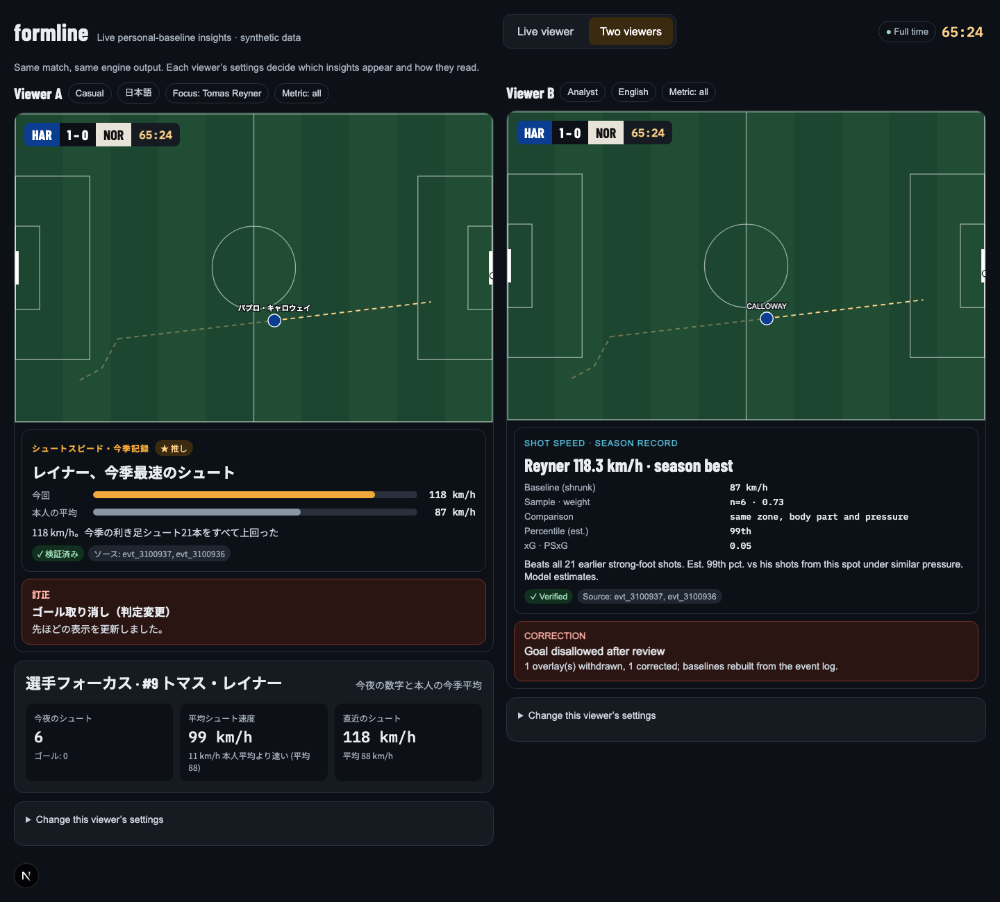

# mwx-hackathon-formline

[](https://github.com/roymwxuk/mwx-hackathon-formline/actions/workflows/ci.yml)

**Formline** — a Synthetic Match Insights Engine for the *Inside the Game* Developer Hackathon
(Microsoft × Premier League). Submissions close **Oct 27, 2026**. Full brief: [HACKATHON_BRIEF.md](HACKATHON_BRIEF.md).

Formline turns synthetic football events into explainable, personalized match intelligence
for studio and streaming use.

## Pipeline

| Stage | Where | Status |
|---|---|---|
| a. Ingest | `generator/` (synthetic feed), `engine/log.py` + `engine/ingest.py` (append-only log, dedupe, reorder window, corrections), `replay.py` | ✅ |
| b. Interpret | `engine/`: shot features (xG, PSxG, placement), like-for-like baselines with empirical Bayes shrinkage | ✅ |
| c. Explain | `engine/insights.py` (deterministic insights with lineage) + `agents/` (Selector, Narrator, Verifier, Composer on Microsoft Agent Framework) | ✅ (Foundry deployment pending) |
| d. Render | overlay contract (`docs/contracts/overlay.schema.json`), timed overlays over SSE, viewer in `frontend/` | ✅ |
| e. Personalize | EN/JA, casual/analyst, favorite clubs and players (card priority), player focus, "my metric" | ✅ (client-side) |



## Agents

The engine decides *what* is notable; agents decide *which* card to show and *how* to word
it, and a deterministic verifier checks every word against the engine's facts. Built as a
`WorkflowBuilder` graph on Microsoft Agent Framework (`backend/src/formline/agents/workflow.py`):

```
Moment ─► Selector ─fan-out─► Narrator[en·casual]  ┐
                              Narrator[en·analyst] ├─► Verifier ─switch─┬─ ok ───► Composer ─► Collector ─► overlays
                              Narrator[ja·casual]  │                    ├─ retry ► same Narrator (with feedback)
                              Narrator[ja·analyst] ┘                    └─ else ─► TemplateFallback ─► Composer
```

| Agent | Kind | Job |
|---|---|---|
| Insight Selector | Rules + LLM | Rules shortlist (salience, cooldowns, rate limit); the LLM picks one card and says why (JSON); falls back to the top candidate |
| Narrator ×4 | LLM | Writes `{tag, headline, sub}` from facts only, per language and audience; retries with the verifier's feedback |
| Verifier | Deterministic | Numbers by kind, names, estimate wording, certainty, language, structure ([catch rate](docs/verifier-catch-rate.md)) |
| Overlay Composer | Deterministic | Fills the fixed template catalog; bars and rows come from facts, so numbers are correct by construction |
| TemplateFallback | Deterministic | After 3 failed attempts, the template narration, which always verifies |

- **Failure recovery:** bad JSON, timeouts and an exhausted budget become verifier failures
  (retry, then template); a run always completes.
- **Corrections:** when VAR overturns a goal, the corrected insight goes back through the
  same workflow and is re-issued as `op: correct`, with a banner citing the shot and the VAR
  events ([screenshot](docs/ui/live/2-var-correction-65m.png)).
- **Cost:** response cache, per-run call budget, precomputed demo overlays (a rerun makes no
  model calls).
- **With or without Azure:** Microsoft Foundry (`FoundryChatClient`) when
  `AZURE_AI_PROJECT_ENDPOINT` is set (see `backend/.env.example`), otherwise a fake model on
  the same Agent Framework path. Tests and CI never need Azure.
- Design rationale: [ADR-008](docs/decisions.md).

## Layout

```
backend/    Python 3.12 · FastAPI · Pydantic · Microsoft Agent Framework (uv)
  src/formline/schema/      DATA_SCHEMA.md and the overlay contract as Pydantic models
  src/formline/generator/   synthetic league, match simulator, realism report
  src/formline/engine/      event log, ingestion, shot features, baselines, insights
  src/formline/agents/      catalog, narrators, verifier, selector, workflow, live orchestration
  data/sample/              committed excerpt of the generated data and example overlays
frontend/   Next.js · React · TypeScript (pnpm): live viewer UI
docs/       roadmap, milestone logs, decisions (ADRs), reports, contracts, UI screenshots
```

## Run locally

```bash
# backend → http://localhost:8000
cd backend
uv sync
uv run formline-gen generate     # writes backend/data/ (seed 2026, ~3 s, ~28 MB)
uv run formline-gen report       # writes docs/realism-report.md
uv run formline-gen overlays     # runs the agents over the live match, caches its overlays
uv run uvicorn formline.api:app --reload
uv run pytest

# frontend → http://localhost:3000 (mock replay by default)
cd frontend
pnpm install
pnpm dev
# or against the backend feed:
NEXT_PUBLIC_STREAM_URL="http://localhost:8000/matches/mtc_s26_md11_har_nor/stream?speed=20" pnpm dev
```

### With Docker

```bash
docker compose up --build        # or docker-compose; then open http://localhost:3000
```

The backend image (~640 MB) builds the synthetic season and the live match's overlays at build
time and runs as a non-root user with a health check; the viewer image (~325 MB) is a Next.js
standalone server. Overlays precomputed with Microsoft Foundry can be shipped in
`backend/demo/overlays/` (see `backend/demo/README.md`).

## Personal baselines: does shrinkage help?

Each shot is compared with the shooter's own comparable shots, blended with his position
group's average by sample size (empirical Bayes, ADR-006). Checked against the generator's
hidden truth (each player's population mean from 300 extra simulated matches),
`uv run python -m formline.evaluation`:

| Shots in history | Raw average error | Shrunk error | Error cut |
|---|---|---|---|
| All players (39) | 4.11 km/h | 2.87 km/h | **30%** |
| 1–4 shots | 6.26 | 3.45 | **45%** |
| 5–9 shots | 5.41 | 3.91 | 28% |
| 10–19 shots | 2.14 | 1.84 | 14% |
| 20+ shots | 2.20 | 2.05 | 7% |

The group average alone is worse than both (5.03 km/h), so baselines must be personal.
Known limitation: 30 matches slightly underestimate the shrinkage strength (k 2.2 fitted vs
3.9 implied for forwards), so the tiniest samples are under-shrunk a little. Details:
[docs/shrinkage-accuracy.md](docs/shrinkage-accuracy.md).

## Verifier: measured catch rate

Every card's text is checked against the engine's facts by a deterministic verifier
(numbers by kind, player and club names, estimate wording, certainty claims, language,
structure). `uv run python -m formline.agents.verifier_eval` injects one error at a time into
the template narrations of all 22 live-match insights × 4 variants (88 cards):

| Error family | Injected | Caught |
|---|---|---|
| Numbers (off by one, ±10%, swapped digits, from another insight) | 313 | 99% |
| Entities (teammate, opponent, other club) | 264 | 100% |
| Missing estimate wording | 58 | 100% |
| Certainty claims | 88 | 100% |
| Structure (too long, missing slot, extra slot) | 264 | 100% |
| Wrong language | 88 | 100% |
| **Overall** | **1,075** | **99.6%**, with 0 false positives on 88 clean cards |

The misses are role confusions: a real fact in the wrong place (his norm shown as this
shot's speed). Details: [docs/verifier-catch-rate.md](docs/verifier-catch-rate.md).

## Feed robustness: convergence under chaos

Real feeds deliver duplicates, late and out-of-order messages, and corrections. The
engine is event-sourced (append-only log, highest version wins) and its baselines use
exact integer arithmetic, so the final state must not depend on delivery order.

`uv run python -m formline.convergence --runs 300` replays the live match 300 times
through the chaos injector with random rates and seeds:

| Check | Result |
|---|---|
| Messages delivered | 464,365 (60,482 duplicates, 62,890 reordered, 7,902 late, 2,098 injected corrections, 1,049 reverts, 3,536 deletes) |
| Baselines == batch rebuild from the log | **300 / 300** |
| Baselines == clean run (no corrections or deletes injected) | **107 / 107** |
| Insights == clean run (also no beyond-window late messages) | **57 / 57** |

Insights describe what was known when a shot happened, so a shot arriving after the
reorder window may legitimately be compared differently. In this sweep late messages
were almost always passes, and insights still matched in 50 of 50 such runs. The same
properties run as `hypothesis` tests in CI (`backend/tests/test_convergence.py`).

## Synthetic data

- **League:** 6 fictional clubs, 18 players each, 30 past matches and 1 live demo match.
  No real clubs, players or match data.
- **Realism:** calibrated against public league aggregates (passes, completion, shots,
  goals, conversion, shot speed). Results and sources: [docs/realism-report.md](docs/realism-report.md).
- **Format:** modeled on the *structure* of industry event and tracking feeds
  (create/update envelopes, versions, freeze frames, tracking shot speed); see
  [DATA_SCHEMA.md](DATA_SCHEMA.md). Each player has a hidden generator-only profile, so
  baseline estimates can be checked against the truth.
- **Sample:** `backend/data/sample/` holds the league, the match list and a live-feed
  excerpt including the VAR correction.

API: `GET /matches`; `GET /matches/{match_id}/league` (both squads with each player's
shrunk season shot-speed norm); and `GET /matches/{match_id}/stream?speed=N`, where each SSE
`data:` line is one viewer `StreamMessage` (`event`, `overlay`, then a final `end`). By default
the stream replays the feed with the overlays cached by `formline-gen overlays`;
`live=true` runs the engine and the agents during the replay; `chaos=true&chaos_seed=N`
replays a chaotic feed (and implies live). The agents use Microsoft Foundry when
`AZURE_AI_PROJECT_ENDPOINT` is set, otherwise a built-in fake model.

## Microsoft and Azure technologies

| Technology | Use | Status |
|---|---|---|
| Microsoft Agent Framework | Multi-agent workflow (`WorkflowBuilder`, executors, fan-out, switch-case retry cycle), `Agent`, chat clients | ✅ In use |
| Microsoft Foundry | Model deployment for the Selector and Narrators (`FoundryChatClient`) | Code ready; deployment pending |
| Azure Container Apps | Hosting backend and viewer, scale to zero | Milestone 4 |
| GitHub Actions | CI: lint, typecheck, tests | Milestone 4 |

Status and plan: [docs/roadmap.md](docs/roadmap.md).
